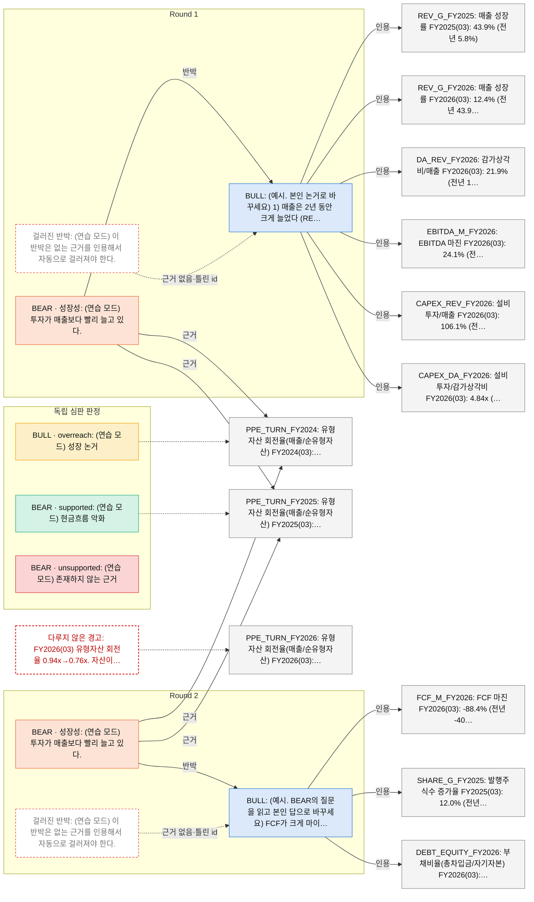

# SAKURA internet (さくらインターネット) (3778.T) 투자 논거 토론

*2026-11-25 16:46 · 연습 모드(가짜 응답, API 호출 없음) · 최종 투자 판단은 사람이 합니다.*

## 토론 전 내 관점
(예시. 본인 관점으로 바꾸세요)
사쿠라인터넷은 정부 지원을 받는 일본 유일 규모의 국산 GPU 클라우드로, 지금의 이익 악화는 선행 투자에 따른 감가상각 때문이며 가동률이 올라오면 마진이 회복된다.

## 토론

### Round 1

**BULL (나)**

(예시. 본인 논거로 바꾸세요)
1) 매출은 2년 동안 크게 늘었다 [REV_G_FY2025][REV_G_FY2026]. GPU 수요가 실제로 매출로 잡히고 있다.
2) 영업이익 적자는 감가상각 부담 때문이고 [DA_REV_FY2026], 감가상각 전 이익인 EBITDA 마진은 아직 20%대다 [EBITDA_M_FY2026].
3) 설비투자가 매출보다 크지만 [CAPEX_REV_FY2026] 성장 투자 단계이므로 정상이다 [CAPEX_DA_FY2026].

**BEAR (AI PM)**

- **성장성**: (연습 모드) 투자가 매출보다 빨리 늘고 있다.  
  근거: PPE_TURN_FY2024, PPE_TURN_FY2025
    - `PPE_TURN_FY2024` 유형자산 회전율(매출/순유형자산) FY2024(03): 1.31x (전년 1.40x)
    - `PPE_TURN_FY2025` 유형자산 회전율(매출/순유형자산) FY2025(03): 0.94x (전년 1.31x)

*근거 id가 없거나 틀려서 자동으로 걸러진 반박 1개:*
- ~~(연습 모드) 이 반박은 없는 근거를 인용해서 자동으로 걸러져야 한다.~~ (인용: ['MADE_UP_2099'])

**인정한 부분:** (연습 모드) 매출 성장 자체는 수치로 확인된다.

**추가로 필요한 자료:** GPU 클러스터 가동률

**가장 어려운 질문:** (연습 모드) 투자금을 회수하는 시점은 언제이고, 그 전에 자금이 부족해지지 않는가?

### Round 2

**BULL (나)**

(예시. BEAR의 질문을 읽고 본인 답으로 바꾸세요)
FCF가 크게 마이너스인 건 맞다 [FCF_M_FY2026]. 다만 2025년 증자로 자기자본을 늘렸고 [SHARE_G_FY2025] 부채비율은 아직 1배 수준이다 [DEBT_EQUITY_FY2026].
가동률과 계약 기간은 재무제표로 확인할 수 없다. 유가증권보고서와 실적발표 Q&A에서 확인해야 한다.

**BEAR (AI PM)**

- **성장성**: (연습 모드) 투자가 매출보다 빨리 늘고 있다.  
  근거: PPE_TURN_FY2024, PPE_TURN_FY2025
    - `PPE_TURN_FY2024` 유형자산 회전율(매출/순유형자산) FY2024(03): 1.31x (전년 1.40x)
    - `PPE_TURN_FY2025` 유형자산 회전율(매출/순유형자산) FY2025(03): 0.94x (전년 1.31x)

*근거 id가 없거나 틀려서 자동으로 걸러진 반박 1개:*
- ~~(연습 모드) 이 반박은 없는 근거를 인용해서 자동으로 걸러져야 한다.~~ (인용: ['MADE_UP_2099'])

**인정한 부분:** (연습 모드) 매출 성장 자체는 수치로 확인된다.

**추가로 필요한 자료:** GPU 클러스터 가동률

**가장 어려운 질문:** (연습 모드) 투자금을 회수하는 시점은 언제이고, 그 전에 자금이 부족해지지 않는가?

## 독립 심판 평가

근거 규율 점수: BULL 2/5, BEAR 4/5

### BULL 주장
| 주장 | 근거 | 판정 | 코멘트 |
|---|---|---|---|
| (연습 모드) 성장 논거 | PPE_TURN_FY2024 | overreach | 한 해 수치로 추세를 말함 |

### BEAR 주장
| 주장 | 근거 | 판정 | 코멘트 |
|---|---|---|---|
| (연습 모드) 현금흐름 악화 | PPE_TURN_FY2025 | supported | 수치가 직접 뒷받침 |
| (연습 모드) 존재하지 않는 근거 | FAKE_ID | unsupported | [자동 검증] 존재하지 않는 근거 id: ['FAKE_ID']. 검증 테스트용 |

**가장 강한 BULL 논거:** (연습 모드)

**가장 강한 BEAR 논거:** (연습 모드)

### 아직 풀리지 않은 질문
- GPU 가동률 → 확인할 곳: 실적발표 Q&A
- [자동 검증] 토론에서 다루지 않은 경고: FY2026(03) 유형자산 회전율 0.94x→0.76x. 자산이 매출보다 훨씬 빨리 늘었다. 가동률은? 계약된 수요가 있는 투자인가? → 확인할 곳: 유가증권보고서·실적발표

### 다음 리서치 단계
1. 유가증권보고서의 설비투자 계획 확인
2. 고객 계약 기간 확인
3. 감가상각 내용연수 확인

## 논증 지도

*파랑 = 내 주장, 주황 = BEAR 반박, 회색 = 근거, 점선 빨강 = 코드가 걸러낸 반박·다루지 않은 경고, 심판 판정: 초록 = 지지됨, 노랑 = 과장, 빨강 = 근거 없음*

## 토론 후 내 관점 (무엇이 바뀌었고 왜)
(예시. 본인 생각으로 바꾸세요)
감가상각 때문이라는 설명만으로는 부족하다. 유형자산 회전율이 계속 떨어지고 있어서 [PPE_TURN_FY2026] '가동률이 오르면 회복'이라는 가정을 숫자로 확인하기 전까지는 확신도를 낮춘다. 다음 단계: 유가증권보고서에서 GPU 설비 가동률·고객 계약 기간·보조금 회계 처리 확인.

## 사용한 근거

- `REV_FY2023` 매출 FY2023(03): 206.2억 JPY
- `REV_FY2024` 매출 FY2024(03): 218.3억 JPY (전년 206.2억 JPY)
- `REV_FY2025` 매출 FY2025(03): 314.1억 JPY (전년 218.3억 JPY)
- `REV_FY2026` 매출 FY2026(03): 353.0억 JPY (전년 314.1억 JPY)
- `REV_G_FY2024` 매출 성장률 FY2024(03): 5.8%
- `REV_G_FY2025` 매출 성장률 FY2025(03): 43.9% (전년 5.8%)
- `REV_G_FY2026` 매출 성장률 FY2026(03): 12.4% (전년 43.9%)
- `GM_FY2023` 매출총이익률 FY2023(03): 26.0%
- `GM_FY2024` 매출총이익률 FY2024(03): 26.3% (전년 26.0%)
- `GM_FY2025` 매출총이익률 FY2025(03): 35.8% (전년 26.3%)
- `GM_FY2026` 매출총이익률 FY2026(03): 22.5% (전년 35.8%)
- `OPM_FY2023` 영업이익률 FY2023(03): 5.3%
- `OPM_FY2024` 영업이익률 FY2024(03): 4.1% (전년 5.3%)
- `OPM_FY2025` 영업이익률 FY2025(03): 13.2% (전년 4.1%)
- `OPM_FY2026` 영업이익률 FY2026(03): -1.1% (전년 13.2%)
- `EBITDA_M_FY2023` EBITDA 마진 FY2023(03): 18.9%
- `EBITDA_M_FY2024` EBITDA 마진 FY2024(03): 19.0% (전년 18.9%)
- `EBITDA_M_FY2025` EBITDA 마진 FY2025(03): 28.7% (전년 19.0%)
- `EBITDA_M_FY2026` EBITDA 마진 FY2026(03): 24.1% (전년 28.7%)
- `DA_REV_FY2023` 감가상각비/매출 FY2023(03): 13.5%
- `DA_REV_FY2024` 감가상각비/매출 FY2024(03): 14.4% (전년 13.5%)
- `DA_REV_FY2025` 감가상각비/매출 FY2025(03): 15.2% (전년 14.4%)
- `DA_REV_FY2026` 감가상각비/매출 FY2026(03): 21.9% (전년 15.2%)
- `CAPEX_REV_FY2023` 설비투자/매출 FY2023(03): 3.7%
- `CAPEX_REV_FY2024` 설비투자/매출 FY2024(03): 16.6% (전년 3.7%)
- `CAPEX_REV_FY2025` 설비투자/매출 FY2025(03): 59.1% (전년 16.6%)
- `CAPEX_REV_FY2026` 설비투자/매출 FY2026(03): 106.1% (전년 59.1%)
- `CAPEX_DA_FY2023` 설비투자/감가상각비 FY2023(03): 0.28x
- `CAPEX_DA_FY2024` 설비투자/감가상각비 FY2024(03): 1.15x (전년 0.28x)
- `CAPEX_DA_FY2025` 설비투자/감가상각비 FY2025(03): 3.89x (전년 1.15x)
- `CAPEX_DA_FY2026` 설비투자/감가상각비 FY2026(03): 4.84x (전년 3.89x)
- `FCF_M_FY2023` FCF 마진 FY2023(03): 15.5%
- `FCF_M_FY2024` FCF 마진 FY2024(03): -3.4% (전년 15.5%)
- `FCF_M_FY2025` FCF 마진 FY2025(03): -40.6% (전년 -3.4%)
- `FCF_M_FY2026` FCF 마진 FY2026(03): -88.4% (전년 -40.6%)
- `CFO_NI_FY2023` 영업현금흐름/순이익 FY2023(03): 5.95x
- `CFO_NI_FY2024` 영업현금흐름/순이익 FY2024(03): 4.43x (전년 5.95x)
- `CFO_NI_FY2025` 영업현금흐름/순이익 FY2025(03): 1.97x (전년 4.43x)
- `CFO_NI_FY2026` 영업현금흐름/순이익 FY2026(03): 28.81x (전년 1.97x)
- `ROE_FY2024` ROE FY2024(03): 7.5%
- `ROE_FY2025` ROE FY2025(03): 15.0% (전년 7.5%)
- `ROE_FY2026` ROE FY2026(03): 0.7% (전년 15.0%)
- `ROIC_FY2024` ROIC(세후 영업이익/투하자본) FY2024(03): 5.2%
- `ROIC_FY2025` ROIC(세후 영업이익/투하자본) FY2025(03): 10.4% (전년 5.2%)
- `ROIC_FY2026` ROIC(세후 영업이익/투하자본) FY2026(03): -0.8% (전년 10.4%)
- `PPE_TURN_FY2023` 유형자산 회전율(매출/순유형자산) FY2023(03): 1.40x
- `PPE_TURN_FY2024` 유형자산 회전율(매출/순유형자산) FY2024(03): 1.31x (전년 1.40x)
- `PPE_TURN_FY2025` 유형자산 회전율(매출/순유형자산) FY2025(03): 0.94x (전년 1.31x)
- `PPE_TURN_FY2026` 유형자산 회전율(매출/순유형자산) FY2026(03): 0.76x (전년 0.94x)
- `NET_DEBT_EBITDA_FY2023` 순차입금/EBITDA FY2023(03): 1.22x
- `NET_DEBT_EBITDA_FY2024` 순차입금/EBITDA FY2024(03): 1.72x (전년 1.22x)
- `NET_DEBT_EBITDA_FY2025` 순차입금/EBITDA FY2025(03): -0.65x (전년 1.72x)
- `NET_DEBT_EBITDA_FY2026` 순차입금/EBITDA FY2026(03): 2.40x (전년 -0.65x)
- `DEBT_EQUITY_FY2023` 부채비율(총차입금/자기자본) FY2023(03): 1.14x
- `DEBT_EQUITY_FY2024` 부채비율(총차입금/자기자본) FY2024(03): 1.36x (전년 1.14x)
- `DEBT_EQUITY_FY2025` 부채비율(총차입금/자기자본) FY2025(03): 0.79x (전년 1.36x)
- `DEBT_EQUITY_FY2026` 부채비율(총차입금/자기자본) FY2026(03): 1.19x (전년 0.79x)
- `INT_COVER_FY2023` 이자보상배율(영업이익/이자비용) FY2023(03): 7.07x
- `INT_COVER_FY2024` 이자보상배율(영업이익/이자비용) FY2024(03): 5.09x (전년 7.07x)
- `INT_COVER_FY2025` 이자보상배율(영업이익/이자비용) FY2025(03): 16.22x (전년 5.09x)
- `INT_COVER_FY2026` 이자보상배율(영업이익/이자비용) FY2026(03): -0.75x (전년 16.22x)
- `SHARE_G_FY2024` 발행주식수 증가율 FY2024(03): 0.1%
- `SHARE_G_FY2025` 발행주식수 증가율 FY2025(03): 12.0% (전년 0.1%)
- `SHARE_G_FY2026` 발행주식수 증가율 FY2026(03): 0.1% (전년 12.0%)