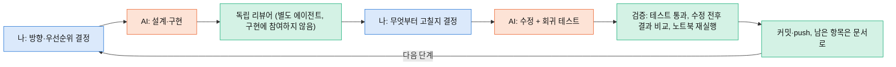
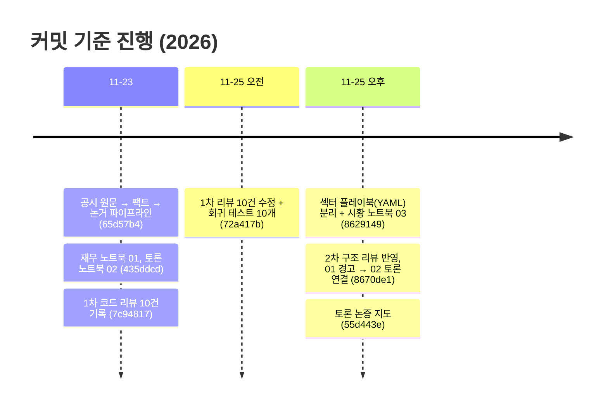
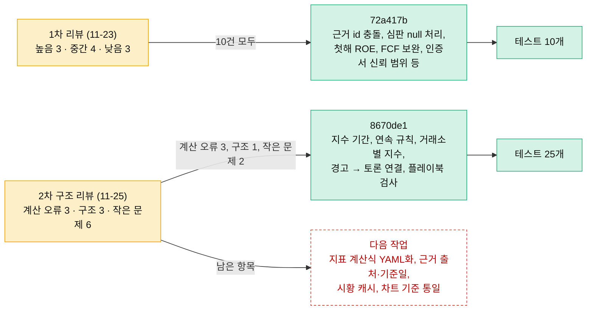

# 만든 과정: 설계 → 리뷰 → 수정 → 재검토

이 저장소는 사람(나)이 방향과 판단을 정하고, AI 코딩 에이전트(Claude Code)가 구현과 검증을 맡는 방식으로 이틀(2026-11-23, 11-25) 동안 만들었습니다. 이 문서는 그 과정을 커밋과 리뷰 문서 기준으로 정리한 것입니다.

## 1. 작업 방식

- 구현한 쪽이 스스로 승인하지 않습니다. 리뷰는 매번 별도 에이전트가 코드만 보고 했습니다.
- 리뷰 결과는 고친 것과 남긴 것을 구분해서 문서로 남겼습니다. 남긴 항목은 다음 작업 목록이 됩니다.

## 2. 타임라인

## 3. 리뷰에서 수정까지

자세한 내용: [1차 리뷰](code_review_2026-11-23.md), [2차 리뷰](code_review_2026-11-25.md)

## 4. 결정 기록

| 시점 | 결정 | 누가 | 이유 |
|---|---|---|---|
| 11-23 | 주제를 아시아 네오클라우드로 | 나 | 관심 업종. 설비투자 부담과 성장 기대가 부딪히는 업종이라, 논거와 반대 논거가 숫자로 명확하게 갈림 |
| 11-23 | 토론 화면은 Jupyter | AI 제안, 내가 채택 | 공고의 Python·Jupyter 요구와 맞고, 계산 과정이 그대로 보임 |
| 11-23 | 근거는 id로만 인용하고 코드가 검사 | AI 제안, 내가 채택 | 모델이 근거 없는 주장을 하면 자동으로 걸러 내기 위해 |
| 11-25 | 새 기능보다 리뷰 수정을 먼저 | 나 | 틀린 숫자 위에 기능을 쌓지 않기 위해 |
| 11-25 | 섹터 기준을 코드에서 YAML 플레이북으로 분리 | 나 | 최종 목표는 섹터를 가리지 않는 리서치 하네스 |
| 11-25 | 리팩터링 전후 결과 비교로 검증 | AI | 3778.T 질문과 근거 id 64개가 수정 전과 같은지 확인 (차이는 표시 자릿수 1곳) |
| 11-25 | 토론을 논증 지도로 시각화 | 나 | 주장·근거·판정의 연결을 한 장으로 보여 주기 위해 |

## 5. 검증 근거

| 커밋 | 회귀 테스트 | 그 밖의 확인 |
|---|---|---|
| 72a417b | 10 | 리뷰 항목마다 재현 테스트 |
| 8629149 | 15 | 리팩터링 전후 3778.T 결과 비교 |
| 8670de1 | 25 | 노트북 01~03 재실행, 다루지 않은 경고가 심판 결과에 추가되는 것 확인 |
| 55d443e | 26 | 논증 지도 생성 테스트 |

테스트는 네트워크 없이 돕니다: `python -m pytest tests -q`
